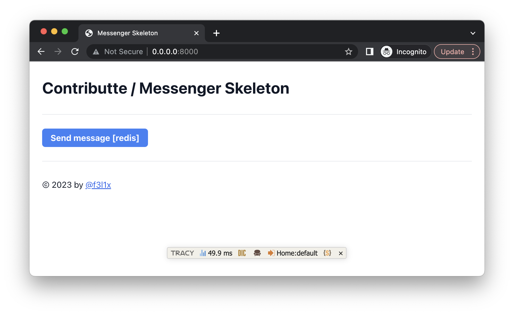
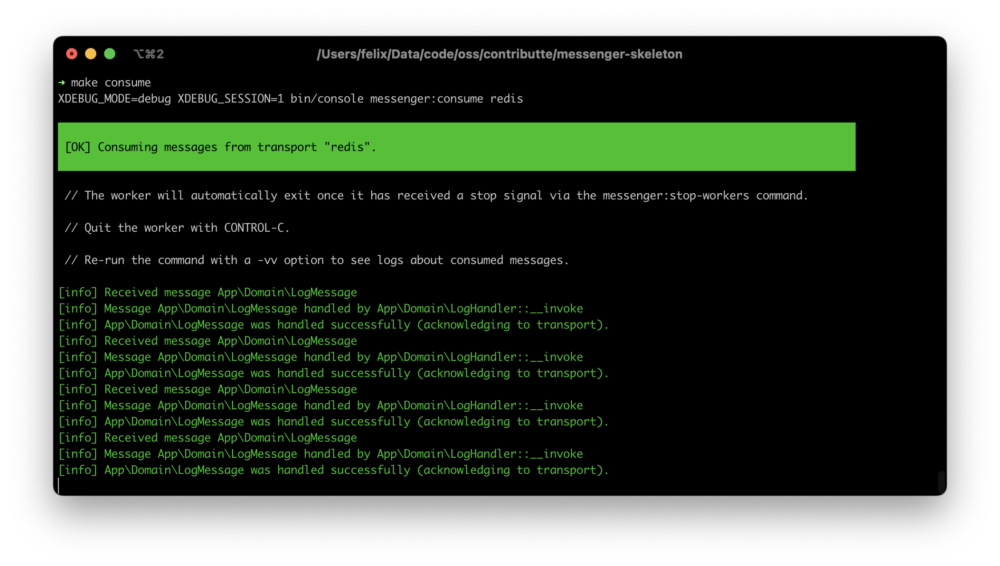

# Contributte Messenger Skeleton

A Composer project skeleton demonstrating Symfony Messenger integration with the Nette framework, including a Redis-routed `LogMessage` example.

<p align="center">
  <a href="https://github.com/contributte/messenger-skeleton/actions"></a>
  <a href="https://codecov.io/gh/contributte/messenger-skeleton"></a>
  <a href="https://packagist.org/packages/contributte/messenger-skeleton"></a>
  <a href="https://packagist.org/packages/contributte/messenger-skeleton"></a>
  <a href="https://github.com/contributte/messenger-skeleton"></a>
</p>

<p align="center">
  
  
</p>

## Runtime Blocker

A clean checkout does not contain a runnable host or Compose configuration. `config/config.neon` configures Redis and PostgreSQL at `0.0.0.0`, while the tracked Compose services are named `redis` and `database` and publish ports to the host. The ignored `config/local.neon` has only an empty tracked template, so the repository provides no tracked override that makes either route internally consistent.

Do not use `0.0.0.0` as a client connection address. A repository-backed local override is required before the application, consumer, or tests that boot the container can connect to services.

## Acquisition

Requirements: PHP 8.4 or later and Composer.

Create a new project from Packagist:

```bash
composer create-project -s dev contributte/messenger-skeleton acme
cd acme
```

`composer create-project` installs dependencies. Create the ignored local configuration file and prepare writable runtime directories:

```bash
make init
make setup
```

The tracked Compose file defines PostgreSQL 15, Redis 7, the web service on `http://localhost:8080`, and Adminer on `http://localhost:8081`; its current application DSNs must be overridden locally before use.

## Intended First Success

After supplying a local service configuration, start the Redis consumer in one terminal:

```bash
make consume
```

Start the development server in another terminal:

```bash
make dev
```

Open `http://localhost:8000`, select **Send message [redis]**, and expect the application to flash `Message dispatched`. The consumer is repository-backed to receive `App\Domain\LogMessage`, invoke `App\Domain\LogHandler`, and append a JSON line containing `Hello!` to `var/tmp/messages.txt`. This route is unexecuted.

The development layout loads Tailwind CSS from `https://cdn.tailwindcss.com`; opening the page makes that third-party request.

## Quality

Run the canonical test suite after dependencies and local configuration are available:

```bash
make tests
```

## Contributing

This project is owned by [Contributte](https://github.com/contributte). See [Contributte's contribution guide](https://contributte.org/contributing.html). Project issues and pull requests are available at [contributte/messenger-skeleton](https://github.com/contributte/messenger-skeleton).

## License

[MIT](LICENSE) © 2023 Contributte.
